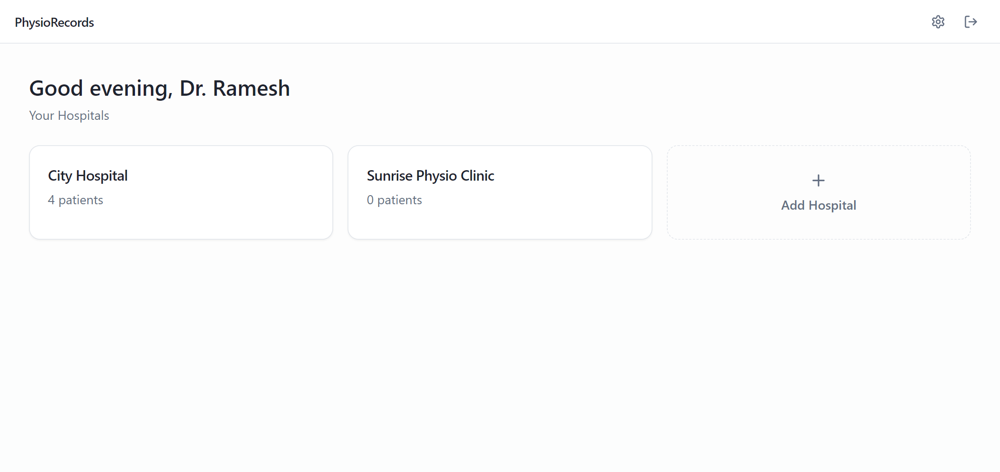
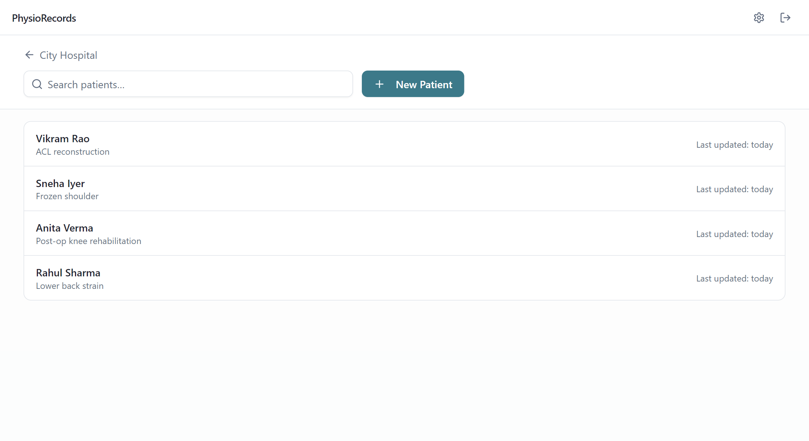
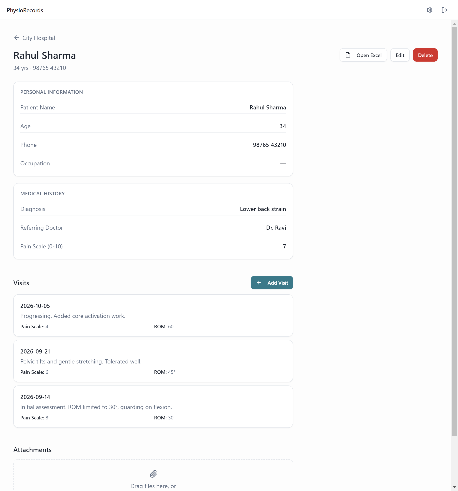

# PhysioRecords

A fully offline desktop app for a physiotherapist who was running his practice out of a single Excel workbook — one worksheet per patient — and had outgrown it.

It keeps the thing he actually liked about Excel (every record is a real `.xlsx` file he can open, read and email) and replaces the thing he didn't (hand-managing dozens of worksheets). Patient data is written as plain JSON, and a formatted Excel mirror is regenerated on every save.

Built for a real user: a non-technical clinician who works across multiple hospitals, has no reliable internet at the clinic, and will never open a terminal. It installs by double-clicking an `.exe` and needs nothing else on the machine.

<p align="center">
  
</p>

---

## What it does

- **Multiple clinics** — patients are organised per hospital, so each clinic's records stay self-contained and can be backed up or handed over independently.
- **Custom intake forms** — the physio defines his own sections and fields (12 field types: text, number, phone, date, dropdown, rating, autocomplete, and so on). Editing a form never breaks existing records; new fields simply render empty on older patients.
- **Visit history** — append-only session notes with freeform measurements (pain scale, range of motion), including backdating so paper history can be typed in.
- **Attachments** — scans and referral letters are copied into the patient's own folder, so nothing depends on a file path elsewhere on the machine.
- **Search & autocomplete** — searches every field, not just names, and suggests values from previous entries at the same clinic.
- **Excel mirror** — every save regenerates a three-sheet workbook (Details / Visits / Attachments) for that patient.
- **One-click backup** — zips the whole records folder with a timestamp.

<p align="center">
  
</p>

<p align="center">
  
</p>

---

## Architecture

Electron, split the conventional way, with a deliberately narrow bridge between the halves.

```
┌─────────────────────────────────────────────────────────────┐
│  Renderer  (React 18 + TypeScript + Tailwind)               │
│  screens/ · components/ — no Node, no filesystem access     │
└───────────────────────────┬─────────────────────────────────┘
                            │  window.api.*   (contextBridge)
┌───────────────────────────┴─────────────────────────────────┐
│  Preload  — the only surface the UI can reach               │
│  ~40 typed functions, each a thin ipcRenderer.invoke        │
└───────────────────────────┬─────────────────────────────────┘
                            │  ipcMain.handle
┌───────────────────────────┴─────────────────────────────────┐
│  Main  — owns every side effect                             │
│  config · hospitals · patients · visits · attachments       │
│  templates · excelSync · backup · hash · atomicWrite        │
└───────────────────────────┬─────────────────────────────────┘
                            │
                   the user's records folder
```

**Process split.** The renderer runs with `contextIsolation` on and has no direct access to Node or the disk. Everything that touches the filesystem, hashes a password or writes a workbook lives in the main process under `src/main/lib/`, one module per concern.

**The IPC bridge.** `src/preload/index.ts` exposes a single `window.api` object built from `ipcRenderer.invoke` calls, typed against `src/shared/types.ts` — the same types the main process uses, so a change to a record's shape is a compile error on both sides rather than a runtime surprise. The renderer cannot reach any channel that isn't deliberately listed there.

**Storage.** The filesystem *is* the database; there's no SQLite, no server.

```
Clinic Records/                 ← folder the user picks on first launch
├── app.config.json             name, Argon2id password hash, security question
├── templates.json              the form library
├── Hospitals/
│   └── City Hospital/
│       ├── hospital.json
│       └── Patients/
│           └── PAT-0001/
│               ├── patient.json      ← source of truth
│               ├── patient.xlsx      ← generated mirror
│               ├── visits/visit-0001.json
│               └── attachments/
└── Backups/
```

Two decisions worth calling out:

- **JSON is authoritative, Excel is derived.** JSON is easy to validate and migrate; the `.xlsx` is rebuilt from it on every write (`excelSync.ts`, via `exceljs`). The user is told plainly in the UI that the spreadsheets are a synced copy.
- **Every write is atomic.** `atomicWrite.ts` writes to a temp file and renames, so a crash mid-save can't leave a half-written patient record. Deleting the app leaves the records folder fully intact and readable in Explorer.

The app remembers which folder it's using via a small pointer file in Electron's `userData` directory — the records themselves never live there. If that folder is moved, the app offers to relocate it rather than silently starting over.

**Auth.** Password and security answer are hashed with Argon2id via [`@node-rs/argon2`](https://github.com/napi-rs/node-rs), chosen over the `argon2` package because it ships prebuilt binaries — the usual package needs a C++ toolchain at install time, which is a non-starter for a double-click installer. Because the app is offline there is no email reset, so recovery is a security question, with a documented fallback: the data is plain JSON on disk and is never at risk, only app access needs resetting.

### Stack

| | |
|---|---|
| Shell | Electron 33, electron-vite |
| UI | React 18, TypeScript, Tailwind CSS, Radix primitives |
| Excel | exceljs |
| Hashing | @node-rs/argon2 |
| Backup | adm-zip |
| Packaging | electron-builder (NSIS installer + portable `.exe`) |

---

## Running it

Requires Node 18+. No database or other services.

```bash
npm install
npm run dev          # launch with hot reload
```

Other scripts:

```bash
npm run typecheck    # main + renderer
npm run lint
npm run build        # compile main, preload and renderer
npm run build:win    # NSIS installer + portable .exe into dist/
```

On first launch the app walks through a short setup (name, password, security question) and asks where to keep the records folder. Nothing is written anywhere else.

---

## Notes

- Windows is the target platform; `electron-builder` is configured for an NSIS installer and a portable `.exe`.
- The build isn't code-signed, so Windows SmartScreen shows an "unknown publisher" prompt on first run. That's expected for a directly distributed app.
- There is no telemetry and no network code anywhere in the app — verified by capturing the renderer's network activity during a full click-through, which shows only local `file://` loads.
